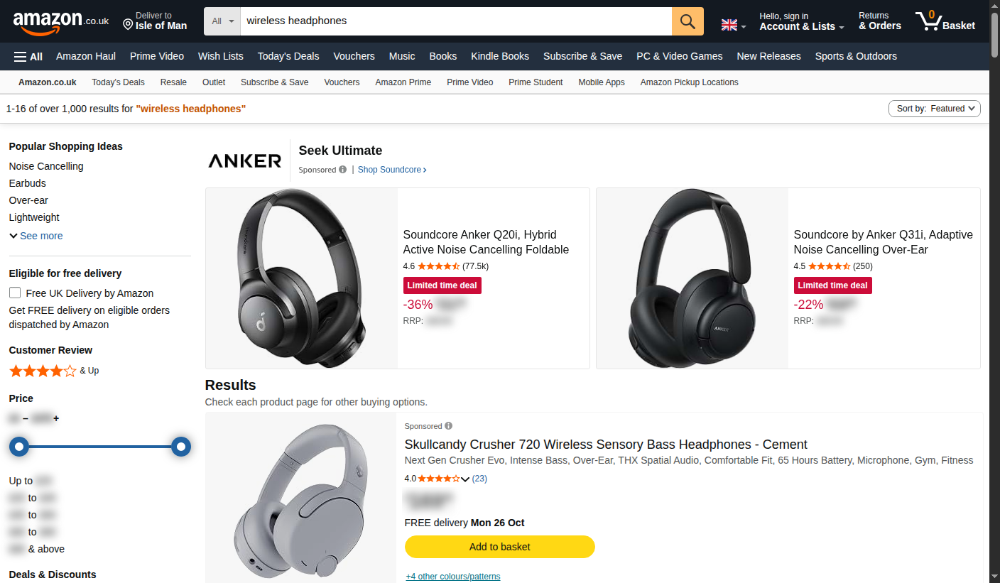
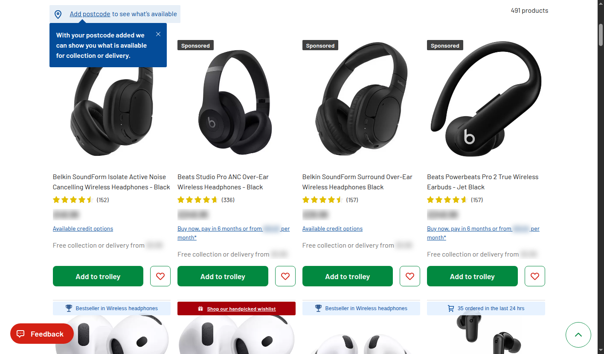
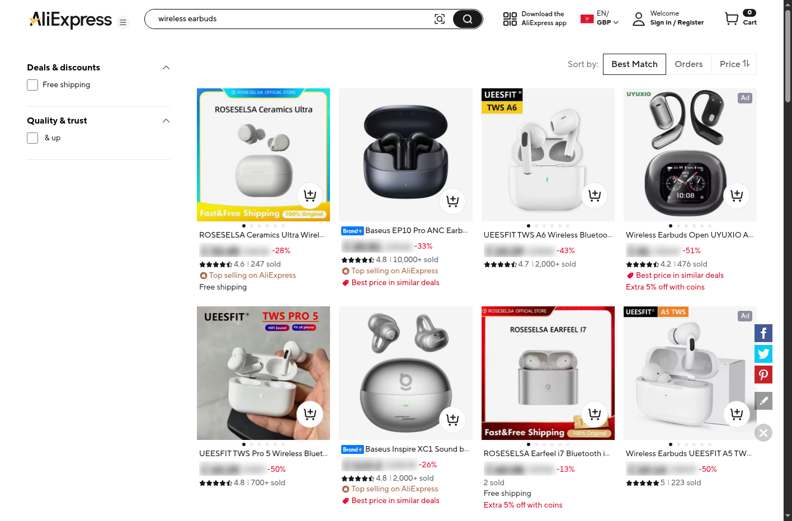

# Price Hider — demo extension

Hides prices on shopping sites so you can browse without price anchoring.
Masked prices keep their space in the layout, so the page looks exactly as it
does normally — you just can't read the numbers.

Works in Chrome and Brave. Built and tested on Chrome 155 and Brave 155.



## Install

### Chrome or Brave, by hand (30 seconds)

1. Download the folder — `git clone` it, or use **Code → Download ZIP** and
   unzip it.
2. Go to `chrome://extensions` (Brave: `brave://extensions`)
3. Turn on **Developer mode** (top right)
4. Click **Load unpacked**
5. Pick the folder containing `manifest.json`
6. Pin the extension so you can reach the popup

Chrome 137+ no longer accepts `--load-extension` on the command line, so this is
the only way to load it. The extension stays loaded across restarts.

### Or script it

On Linux/macOS, `install-into-profile.py` writes the same preference the Load
unpacked button writes. Close the browser first or it overwrites the file.

```bash
python3 install-into-profile.py chrome
python3 install-into-profile.py brave
```

## Using it

- **Hold Shift** to reveal every price on the page
- **Hover** one price for a moment to reveal just that one
- **Popup**: on/off, blur or hide style, Shift-peek toggle, shopping-sites-only
  toggle, live masked count, and a rescan button
- **Extra selectors**: if a shop's markup defeats the detector, type a CSS
  selector into the popup (for example `.product-price`) and it's added to the
  match list immediately

## Try it locally

`test-shop.html` is a fake shop with six products and a basket. Serve it over
HTTP rather than opening the file directly — `file://` URLs need a separate
permission toggle.

```bash
python3 -m http.server 8899
# then open http://127.0.0.1:8899/test-shop.html
```

Every price should be blurred. Ratings ("4.6"), sizes ("500ml"), battery life
("40h"), delivery times ("2–3 weeks") and screen sizes ("27-inch") should all
stay sharp. The footer of the test page lists exactly what should and should not
be masked.

## Real-site results

Measured, not guessed. The counts come from a mask/unmask assertion run against
the live site, and every run is backed by a screenshot I actually looked at —
a DOM count on its own lies (see the notes below). Price counts move between
loads because these pages lazy-render, so the percentage is the number that
matters.

| Site | Prices masked | Readable prices left |
|---|---|---|
| Amazon UK | 100% (183–239 per load) | 0 |
| Argos | 100% (264) | 0 |
| eBay UK | 100% (142–146) | 0 |
| Sports Direct | 100% (92–97) | 0 |
| AliExpress | 100% (full grid, by inspection) | 0 |
| Local test page | 100% (11) | 0 |

Ratings, review counts, battery life, sizes, delivery text, "sold" counts and
discount badges stay sharp on all of them.

Two bugs this table hid at first, both now fixed:

- AliExpress emits a **fullwidth pound sign** (`￡`, U+FFE1) rather than `£`.
  Identical on screen, invisible to an ASCII character class — every item price
  was skipped while the offer badges (plain ASCII) got masked.
- Temu and other discount shops write sub-£1 prices as **`87p`**, with no
  currency symbol at all.



## How it works

The content script runs at `document_start` so prices are hidden before the page
paints. It works in three stages:

1. **Split-price widgets** — some shops (Amazon) put the symbol and digits in
   separate spans, so no single text node reads as a price. If a tight element's
   whole text is exactly a price, that element is masked as a box.

2. **Price tokens** — only the price substring inside a text node is wrapped and
   blurred, so "Free delivery from £4.95" loses the £4.95 and keeps the words.

3. **Lazy content** — a `MutationObserver` scans everything a page adds, so
   React-rendered grids and infinite scroll get masked as they appear.

A number only counts as a price if it carries a currency symbol or code
(`£129.00`, `$249.99`, `GBP 349.00`) or is written as pence (`87p`). That's why
"4.6 stars", "500ml", "2–3 weeks" and "27-inch" pass through untouched.



## Known limits

- **Not a security feature.** The prices are still in the page; the text is only
  blurred. Anyone who opens DevTools can read them. It's for not seeing prices
  at a glance, not for stopping access.
- A bare number with no currency symbol or code is left alone, so a shop that
  renders prices as plain "129.00" will not be masked.
- Discount percentages ("-30%", "UP TO 70% OFF") stay sharp — they are not
  prices. Worth knowing if a badge gives the saving away.
- Some shops render prices inside canvas elements or images. Those can't be
  masked by text matching.
- Sites whose price markup is wildly unusual may need an extra selector from the
  popup.
- `file://` pages need **Allow access to file URLs** switched on in the
  extension's details page.

## Files

```
manifest.json              Manifest V3 definition
content.js                 detection and masking
content.css                blur / hide styles
background.js              seeds defaults, sets the badge count
popup.html / popup.js      the popup UI
icons/                     16, 48, 128 px
test-shop.html             fake shop for testing
install-into-profile.py    loads it into a Chrome/Brave profile
```

## Licence

MIT — it's a demo, take it apart.
